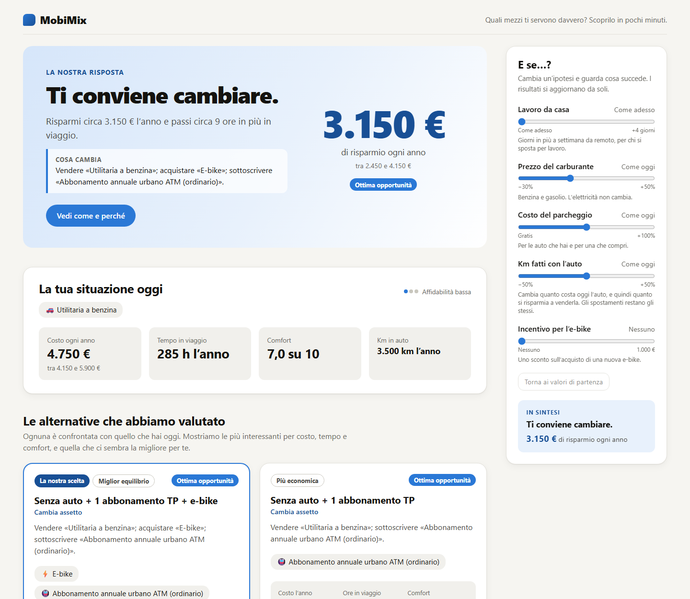

# MobiMix Personal

A personal **mobility portfolio advisor**. Given how a person or household actually lives and moves,
which combination of owned vehicles, subscriptions and pay-per-use services fits best - in terms of
cost, travel time and comfort? Should you keep your second car, take a transit pass, buy an e-bike?



MobiMix does not optimise a single trip. A short questionnaire (about a dozen questions; what the user
does not know is estimated) becomes a year of mobility needs; the app builds the plausible
alternatives to what the household has today, throws out those that could not serve its needs, and
compares the rest against today on cost, time and comfort - with the reasons, and with the uncertainty
of every estimate said out loud. The interface is in Italian and the first reference data are those of
Milan.

> **Estimates, not advice.** Many reference values are still placeholders (every one is flagged:
> see [docs/assumptions.md](docs/assumptions.md)); the results illustrate the method and are not a
> recommendation to sell a car.

- Product and modelling brief: [MOBIMIX_PROJECT.md](MOBIMIX_PROJECT.md)
- How to work on the repository: [CLAUDE.md](CLAUDE.md)
- Methodology, data sources, assumptions: [docs/](docs/)

## How it works

```text
questionnaire -> mobility needs -> current setup -> candidate setups -> feasibility
              -> who serves which need -> cost / time / comfort -> recommendations -> explanation
```

Each stage is a small replaceable module, deterministic and inspectable; the whole analysis is one
function call (`analyze`), so it can run without the web app. Every number lives in an editable file
under [data/](data/) with its source and confidence. [docs/methodology.md](docs/methodology.md)
explains every formula and every simplification.

## Status

| Step | | |
|---|---|---|
| 1 | Repository skeleton | done |
| 2 | Domain models | done |
| 3 | Editable reference data | done (first values from web sources; many are placeholders) |
| 4 | Questionnaire (8-screen wizard, 12 questions, adaptive) | done |
| 5 | Demand estimator (profile -> missions with provenance) | done |
| 6 | Cost model and cost of the current portfolio | done |
| 7 | Candidate portfolio generator (fleet x add-on set x services, with the changes each implies) | done |
| 8 | Feasibility checker (which means serve each need, which portfolios are rejected and why) | done |
| 9 | Mode assignment (which of its means serves each need, how often, and why) | done |
| 10 | Evaluation (cost anchored to the declared one, time, comfort, car km, CO2) | done |
| 11 | Recommendations (current / cheapest / balanced / fastest, with the reasons) | done |
| 12 | Results screen (the answer, today, the alternatives, comparison charts and table) | done |
| 13 | What-if panel (fuel, parking, remote work, car km, e-bike incentive) | done |
| 14 | Tests and documentation pass | in progress |

## API

The questionnaire's answers become a validated `UserProfile` and are sent to `POST /api/analyze`,
which returns the whole analysis. Each stage of the analysis also has an endpoint (interactive
documentation at `/docs` when the backend runs):

| Endpoint | Returns |
|---|---|
| `POST /api/profile/estimate-demand` | annual mobility needs of a profile |
| `POST /api/profile/current-cost` | what the current setup costs per year, with a range, a confidence and the answers that would narrow it |
| `POST /api/portfolios/generate` | the candidate setups to compare with the current one |
| `POST /api/portfolios/feasibility` | the current setup and every candidate, with the means that serve each need and the reasons a setup is rejected |
| `POST /api/portfolios/assignment` | the same, and for every feasible one how often each means serves each need, and why |
| `POST /api/portfolios/evaluate` | for each of those: annual cost, travel time, comfort, car kilometres, CO2 |
| `POST /api/analyze` | everything above plus the recommendations and their explanation |
| `POST /api/scenario` | the same analysis under what-if assumptions (fuel price, parking, remote work, car km, e-bike incentive) |

## Layout

```text
backend/    FastAPI + Pydantic (Python 3.12+)
  app/models/      domain models (profile, demand, options, portfolio, evaluation, recommendation)
  app/services/    one sub-package per pipeline stage + interfaces.py + pipeline.py
  app/data/        loader and audit of the reference data
  app/api/         HTTP layer
  tests/
frontend/   React + Vite + TypeScript
  src/form/        questionnaire logic (pure): form state, rules, mapping to the profile
  src/steps/       one component per questionnaire screen
  src/results/     the results screen and the what-if panel
  src/components/  small reusable controls
data/       editable reference data (YAML) - all model assumptions live here
docs/       methodology, data sources, assumptions
```

## Run locally

Prerequisites: Python 3.12+ and Node.js 22.18+ (24 recommended; the tests run TypeScript directly).

**Windows (PowerShell)**

```powershell
# backend
cd backend
python -m venv .venv
.\.venv\Scripts\Activate.ps1
pip install -e ".[dev]"
uvicorn app.main:app --reload        # http://127.0.0.1:8000 - interactive docs at /docs

# frontend, in a second terminal
cd frontend
npm install
npm run dev                          # http://localhost:5173 - /api is proxied to the backend
```

**macOS / Linux**

```bash
cd backend && python -m venv .venv && source .venv/bin/activate
pip install -e ".[dev]" && uvicorn app.main:app --reload

cd frontend && npm install && npm run dev      # in a second terminal
```

Checks (the same that run on every push, see [.github/workflows/ci.yml](.github/workflows/ci.yml)):

```powershell
cd backend
pytest                               # models, reference data, every stage of the analysis, API
ruff check .                         # lint
ruff format --check .                # format

cd ..\frontend
npm run lint
npm test                             # questionnaire mapping, number formatting, results screen
npm run build                        # type-check + production build
```

Environment variables are listed in [.env.example](.env.example); none are required for local use.
Docker is not set up.

## Reference data

Every number the model uses is in [data/](data/) and carries its provenance:

| File | Content |
|---|---|
| `model_parameters.yaml` | energy prices, emission factors, national statistics, calendar, valuation, assignment and recommendation tunables |
| `mobility_options.yaml` | owned assets (cars, scooter, motorcycle, bicycle, e-bike) and walking |
| `tariffs.yaml` | subscriptions and pay-per-use services (PT, rail, taxi, sharing, rental, air) |
| `comfort_scores.yaml` | comfort / flexibility / reliability per option (all placeholders) |
| `default_profiles.yaml` | statistical defaults by residential context (all placeholders) |
| `mission_templates.yaml` | typical characteristics of each kind of mission (all placeholders) |
| `questionnaire.yaml` | answer bands of the numeric questions (those that turn words into numbers are placeholders) |
| `portfolio_rules.yaml` | which candidate portfolios are generated: add-on sets, vehicles bought, services (placeholder) |
| `feasibility_rules.yaml` | categorical rules of the feasibility check: occasional-only means, children, accessibility, hours (placeholder); the numeric thresholds are `feasibility.*` in `model_parameters.yaml` |
| `assignment_rules.yaml` | tables of the mode assignment: hours spent at the destination, weight of the weather (placeholder); the tunables are `assignment.*` in `model_parameters.yaml` |
| `sources.yaml` | bibliographic sources cited by the values above |
| `demo_households/` | the five fixed demo profiles used for regression tests |

Each value has `confidence`, an optional `source`, a `placeholder` flag and `notes`. Files are
validated on load (unknown fields, missing sources, missing scores...). To list what is still a
placeholder or unsourced:

```powershell
cd backend
python -m app.data.audit --output ..\docs\assumptions.md
```

## Questionnaire

The wizard has 8 screens (household, location, work/study, cars, other vehicles and
subscriptions, weekend/holidays/services, priorities, summary) covering 12 questions. Questions
adapt to earlier answers: no cars means no mileage or parking questions, two cars add "how often
are both needed at the same time?", no weekend trips means no distance question. Answers are
saved in the browser (no accounts, nothing is stored on the server); "Ricomincia" clears them.

Numeric questions accept a band, an exact value or "Non so" (the model then estimates it). In
development (`npm run dev`) a selector in the header loads one of the demo households, and
`http://localhost:5173/?demo=urban_single` opens the results of that household directly
(`&theme=dark` forces the dark scheme, `&whatif=fuelPct:30,remoteDays:2` starts with those assumptions).

## License

No license has been chosen yet: until one is added, all rights are reserved.
